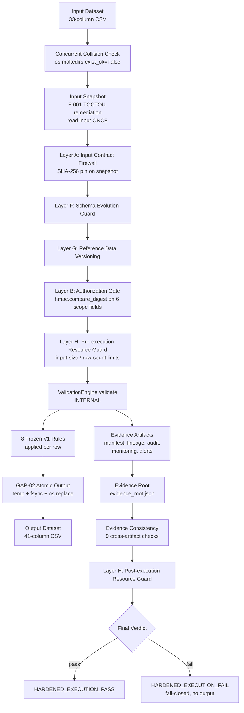
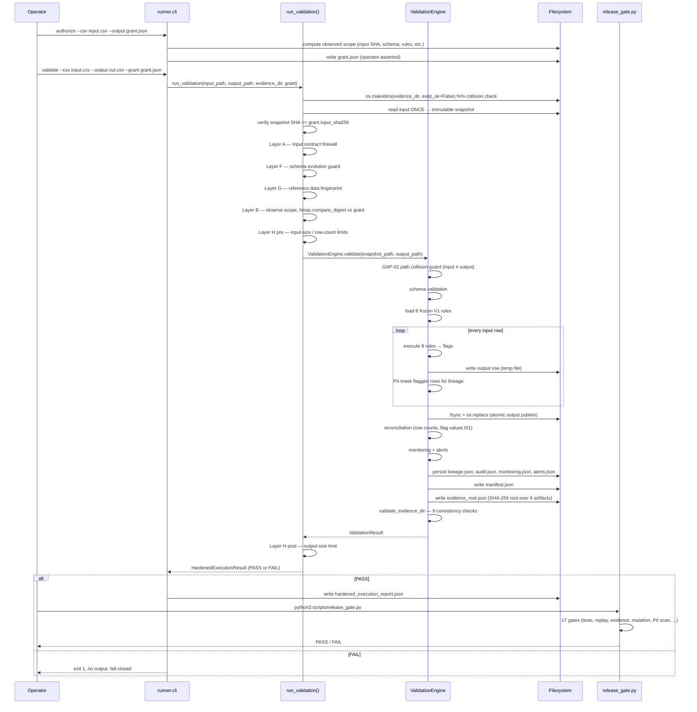
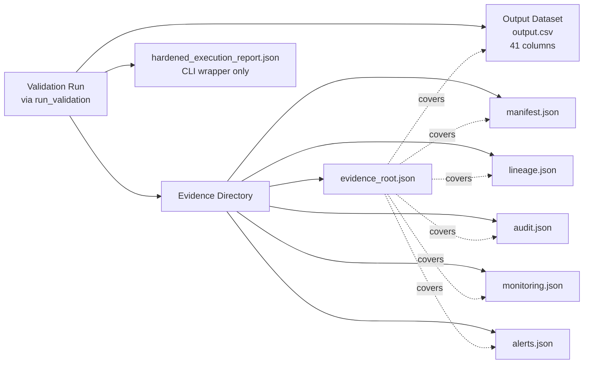

# DQAEIP-FINAL-HARDENED-V1

**Data Quality Assurance & Evidence Integrity Platform — V1**

- Package version: `3.1.0`
- Internal hardened label: `3.1.0-hardened`
- Final verdict: **GREEN — PRODUCTION READY WITH CONDITIONS**

---

## 1. Overview

DQAEIP is a deterministic, flag-only consumer data-quality validation
platform. Its single production job is:

> Read a 33-column input CSV → apply 8 frozen V1 validation rules →
> write a 41-column output CSV (33 source columns + 8 flag columns) →
> emit tamper-evident, semantically validated evidence → produce a final verdict.

The platform is **fail-closed**: any unrecoverable inconsistency in the
input, schema, rule set, authorization, or evidence chain blocks
execution rather than producing a degraded output.

**What DQAEIP does:**

- Validates input data against 8 frozen V1 rules.
- Produces a 41-column output CSV (33 source + 8 flag columns).
- Generates tamper-evident evidence artifacts with cross-artifact consistency checks.
- Enforces operator-asserted authorization at the execution boundary.
- Provides deterministic, byte-identical output replay.

**What DQAEIP does NOT do:**

- It does NOT modify, clean, or delete source records (validation only).
- It does NOT provide cryptographically independent authorization (no GPG, no signing key, no trust anchor).
- It does NOT provide externally anchored evidence authentication by default (protected mode is OPT-IN).
- It does NOT enforce wall-time or RSS limits in-process (deployment-level control required).
- It does NOT stream — the engine materializes the full dataset in memory (O(N)).
- It does NOT process real customer data yet (synthetic-only validation).

Production readiness has been demonstrated on synthetic data. First
customer-data processing remains an operational acceptance milestone.

---

## 2. Architecture

The system has exactly ONE production execution path: `run_validation()`
in `data_quality_platform/hardening/pipeline.py`. The CLI, Airflow DAG,
and any application code MUST route through this boundary.

### Main components that actually exist

| Component | Location | Role |
|-----------|----------|------|
| `run_validation()` | `data_quality_platform/hardening/pipeline.py` | Single production execution boundary (authorization + safety) |
| `AuthorizationScope` / `evaluate_authorization` | `data_quality_platform/hardening/authorization.py` | Layer B — `hmac.compare_digest` on 6 scope fields |
| `validate_input_contract` | `data_quality_platform/hardening/input_contract.py` | Layer A — input firewall |
| `assess_schema_evolution` | `data_quality_platform/hardening/schema_guard.py` | Layer F — schema evolution guard |
| `fingerprint_reference_data` | `data_quality_platform/hardening/reference_data.py` | Layer G — reference data versioning |
| `ResourceLimits` / `check_pre_execution` / `check_post_execution` | `data_quality_platform/hardening/resource_guard.py` | Layer H — input/row/output size limits (pre/post) |
| `ValidationEngine` | `data_quality_platform/validation/engine.py` | INTERNAL — applies 8 rules, writes output, persists evidence |
| `RuleRegistry` / 8 rules | `data_quality_platform/rules/` | Frozen V1 rule set (SHA-256 pinned) |
| `compute_evidence_root` / `write_evidence_root` / `verify_evidence_root` | `data_quality_platform/validation/evidence_root.py` | Tamper-evident SHA-256 root hash |
| `verify_evidence_root_with_external_anchor` | `data_quality_platform/validation/evidence_root.py` | OPT-IN external-anchor verification (F-003 mitigation) |
| `validate_evidence_dir` | `data_quality_platform/validation/evidence_consistency.py` | 9 cross-artifact consistency checks |
| `PIIMasker` / `scan_for_prohibited_content` | `data_quality_platform/security/__init__.py` | PII masking (defense-in-depth) + heuristic scanner |
| `runner/cli.py` | `runner/cli.py` | CLI shell — calls `run_validation()` |
| `airflow/dags/dq_validation_dag.py` | `airflow/dags/dq_validation_dag.py` | Airflow DAG — calls `run_validation()` |
| `scripts/release_gate.py` | `scripts/release_gate.py` | 17-gate release verification |

**ValidationEngine is an internal implementation component.** Production
execution MUST enter through `run_validation()`. Direct ValidationEngine
invocation is not a supported production execution path. Tests and dev
tooling (benchmark, replay) may instantiate the engine directly — those
are not production paths.

Authorization is **operator-asserted authorization, NOT cryptographically
independent authorization**. The grant is a JSON file pinning 6 scope
fields compared via `hmac.compare_digest`. There is no GPG, no signing
key, no trust anchor, no identity verification.

---

## 3. Data Flow

The following diagram reflects the ACTUAL execution order in
`run_validation()`. Each box is a verified code path, not an aspirational
design.



**Key invariants in the data flow:**

- The input is read exactly ONCE into an immutable snapshot (F-001 fix). All
  subsequent operations use the snapshot, not the original `input_path`.
- Authorization is verified AFTER the snapshot exists, so the authorized
  bytes == observed bytes == executed bytes.
- The output is published atomically via `os.replace` — a crash during
  generation never leaves a partial file at the final output path.
- Evidence is generated and verified INSIDE `run_validation()` before the
  verdict is returned.

---

## 4. Validation Flow

The sequence below shows the full validation lifecycle, including
operator-side actions (grant creation, release gate execution).



**Step-by-step explanation:**

1. **Input received** — the operator supplies a 33-column CSV path.
2. **Input snapshot** — `run_validation()` reads the file ONCE into an
   immutable temp file (the snapshot). All subsequent reads use the
   snapshot, closing the F-001 TOCTOU window between authorization and
   execution.
3. **Authorization verification** — the snapshot's SHA-256 is compared
   against `grant.input_sha256`. Layer B then recomputes the full
   observed scope (input SHA, schema fingerprint, V1 ruleset SHA,
   reference data fingerprint, config fingerprint, execution mode,
   software identity) and compares each field via `hmac.compare_digest`.
   Any divergence → `AUTHORIZATION_REJECTED`, engine never invoked.
4. **Rule loading** — `RuleRegistry.create_default()` loads the 8 frozen
   V1 rules. The V1 ruleset SHA-256 is pinned to `daef1ded…`.
5. **Validation** — the engine streams the snapshot row-by-row, applying
   all 8 rules per row and producing flag values (0 or 1).
6. **Output generation** — rows are written to a temp file on the same
   filesystem as the final output, then atomically published via
   `os.replace` after `fsync` (GAP-02).
7. **Evidence generation** — the engine persists `manifest.json`,
   `lineage.json`, `audit.json`, `monitoring.json`, `alerts.json`, and
   `evidence_root.json` inside `evidence_dir`.
8. **Evidence verification** — `validate_evidence_dir()` runs 9
   cross-artifact consistency checks; `write_evidence_root()` records the
   tamper-evident SHA-256 root. If consistency fails, the run is recorded
   as failed.
9. **Release gate** — `scripts/release_gate.py` runs 17 gates including
   unit/contract/integration/safety tests, deterministic replay, evidence
   validation, PII scan, negative battery, and mutation testing.
10. **Final result** — `HardenedExecutionResult` returns `PASS` only if
    every layer accepted and the engine returned `success=True`. Any
    failure is fail-closed: no output, no partial evidence.

---

## 5. Outputs

A single validation run produces the following artifacts. All filenames
are the ACTUAL names written by the engine — no invented names.



| Artifact | Producer | Purpose | Consumer | Authoritative | Covered by evidence root | Used by release gate |
|----------|----------|---------|----------|----------------|---------------------------|----------------------|
| `output.csv` (operator-supplied path) | `ValidationEngine` | 41-column validated dataset | Operator / downstream pipeline | Yes | Yes (via `output_csv=` parameter) | Yes (gate 12 deterministic replay, gate 13 evidence validation) |
| `manifest.json` | `ManifestWriter` | Run summary: row counts, schema hash, rule hashes, flag counts, reconciliation, generated_files | Operator / evidence validator | Yes | Yes | Yes (gates 12, 13) |
| `lineage.json` | `LineageRecorder` | Per-row flagged-row records (PII-masked, capped at 1000 entries) | Operator / auditor | Yes | Yes | Yes (gates 12, 13, 14 PII scan) |
| `audit.json` | `AuditTrail` | Ordered audit events with timestamps | Operator / auditor | Yes | Yes | Yes (gates 12, 13, 14) |
| `monitoring.json` | `QualityMonitor` | Quality scores + SLA results per dimension | Operator | Yes | Yes | Yes (gates 12, 13) |
| `alerts.json` | `AlertManager` | SLA breach + validation failure alerts | Operator | Yes | Yes | Yes (gates 12, 13) |
| `evidence_root.json` | `write_evidence_root` | SHA-256 root hash over the 6 core artifacts (tamper-evident anchor) | Evidence verifier | Yes | N/A — it IS the root | Yes (gate 13) |
| `hardened_execution_report.json` | `runner.cli.cmd_validate` (CLI wrapper) | Machine-readable copy of `HardenedExecutionResult` | Operator | No (CLI-level, not engine-level) | No | No |

---

## 6. Evidence Integrity

Two distinct layers protect evidence:

### Tamper detection (default mode)

`write_evidence_root()` computes a SHA-256 root hash over the 6 core
artifacts (manifest, output, lineage, audit, monitoring, alerts). The
root is stored in `evidence_root.json` INSIDE the evidence directory.
`verify_evidence_root()` recomputes the root and compares against the
recorded value. Any modification to any covered artifact — including
adding or removing an artifact — invalidates the root.

### Semantic consistency validation

`validate_evidence_dir()` performs 9 cross-artifact consistency checks:
required artifacts exist, JSON parseable, manifest schema, run ID
consistency, row count agreement, flag count agreement, verdict
agreement, lineage serialization, and referenced artifact hashes. Both
layers are active in the execution path: the engine calls them after
writing evidence; if either fails, the run is recorded as failed.

### External-anchor protected mode (OPT-IN)

`verify_evidence_root_with_external_anchor(evidence_dir, expected_root,
output_csv=None)` treats the evidence directory as attacker-controlled
and requires the caller to supply a 64-char hex `expected_root` from an
out-of-band trust source. Fail-closed behavior:

- `expected_root` missing / malformed → fail closed
- Recomputed root ≠ `expected_root` → fail
- Recorded root (inside the dir) ≠ `expected_root` → fail
- Any tamper-detection signal → fail

External-anchor verification is currently OPT-IN and is not automatically invoked by the CLI, Airflow, or release-gate execution paths. It is invoked only by tests today. Operators wishing to authenticate evidence against an attacker-controlled evidence directory MUST call `verify_evidence_root_with_external_anchor(evidence_dir, expected_root, output_csv=...)` manually after each run, supplying an `expected_root` from an independent out-of-band trust channel. DQAEIP itself does not protect or generate the external anchor.

F-003 is mitigated under protected external-anchor mode. Protected mode is
OPT-IN and is not automatically invoked by the current CLI, Airflow, or
release-gate execution paths.

### Concurrent collision prevention

`run_validation()` atomically claims `evidence_dir` via
`os.makedirs(evidence_dir, exist_ok=False)`. The first execution wins; the
second fails closed at `stopped_at=evidence-dir-collision`. No
last-writer-wins. No evidence mixing. The first run's artifacts are
preserved untouched.

### Evidence directory boundary

The evidence root covers artifacts INSIDE `evidence_dir` plus the output
CSV (supplied via `output_csv=` since it typically lives outside the
evidence dir). Path traversal and symlink concerns are mitigated by
`Path.resolve()` in the GAP-01 guard, but the evidence directory itself
is treated as a trusted location under operator control.

---

## 7. Authorization

Authorization is enforced at the execution boundary by **Layer B**
(`data_quality_platform/hardening/authorization.py`).

### Authorization artifact (the grant)

The grant is a JSON file produced by `runner.cli authorize`. It pins
6 scope fields:

1. `input_sha256` — SHA-256 of the input file
2. `schema_fingerprint` — SHA-256 of the authorized column-list JSON
3. `v1_ruleset_sha256` — SHA-256 of `v1_rules.py` (pinned constant `daef1ded…`)
4. `reference_data_fingerprint` — SHA-256 of the reference data bundle
5. `config_fingerprint` — SHA-256 of the canonical configuration JSON
6. `software_identity` — map of module-label → SHA-256 for 5 production modules

Plus `execution_mode` (one of `validation`, `export`, `mutation_testing`,
`benchmark`).

### Snapshot hash binding

`run_validation()` reads the input ONCE into an immutable snapshot and
verifies `snapshot_sha == grant.input_sha256` BEFORE any other operation.
This closes the F-001 TOCTOU window: authorized bytes == observed bytes
== executed bytes.

### Tamper rejection (fail-closed)

The observed scope is recomputed from the actual files at run time and
compared field-by-field via `hmac.compare_digest`. Any divergence yields
`AUTHORIZATION_REJECTED` and the engine is NEVER invoked. A missing grant
(`None`) or unobservable scope is also fail-closed.

13 negative tests cover every scope field tamper, wrong execution mode,
missing grant, missing observed scope, and verify the engine never runs
on a rejected scope.

### Execution paths

| Path | Entry point | Authorization enforced? |
|------|-------------|--------------------------|
| CLI | `runner.cli.cmd_validate` → `run_validation()` | YES |
| Airflow | `airflow.dags.dq_validation_dag._run_validation_task` → `run_validation()` | YES |
| Direct `ValidationEngine.validate()` | internal | NO — not a production path |

DQAEIP does **not** implement identity-based authentication. The grant
is operator-asserted: anyone with read access to the grant file can
validate; anyone with write access to the grant file can authorize any
input. Filesystem ACLs are the operator's responsibility.

---

## 8. Deterministic Replay

Deterministic replay was verified by running the same 1,000,000-row input
through `run_validation()` twice and comparing the output CSVs
byte-for-byte.

| Property | Value |
|----------|-------|
| Method | Two independent 1M-row runs, same input, same code |
| Output SHA-256 (run 1) | `5f695d9dd4c33840571cfbb92a3dabde5866ae196e03bc5d4d67eb83782e2c35` |
| Output SHA-256 (run 2) | `5f695d9dd4c33840571cfbb92a3dabde5866ae196e03bc5d4d67eb83782e2c35` |
| Byte-identical | YES |

> **The deterministic invariant is the OUTPUT CSV (the validated data).**
> Evidence files (`audit.json`, `lineage.json`, `manifest.json`) include
> per-run timestamps, so their SHA-256 hashes — and therefore the
> evidence root — will DIFFER across runs even when the output is
> byte-identical. This is by design. The release gate (gate 12) verifies
> output byte-identity, not evidence-root identity.

---

## 9. Concurrency Protection

`run_validation()` performs an atomic directory claim at the very start
(after the missing-grant check):

```python
try:
    os.makedirs(evidence_dir, exist_ok=False)
except FileExistsError as exc:
    # fail-closed at stopped_at=evidence-dir-collision
    return HardenedExecutionResult(verdict=FAIL, ...)
```

### Properties

- **First execution wins** — atomically creates the directory.
- **Second execution fails closed** — returns immediately with
  `stopped_at=evidence-dir-collision`; writes NOTHING to the shared dir.
- **No last-writer-wins** — the first run's `manifest.json`,
  `evidence_root.json`, etc. are preserved untouched.
- **No evidence mixing** — the second run's snapshot work directory is
  never created.

### Live verification

A threaded concurrent test (two threads, same `evidence_dir`) confirmed:
exactly 1 thread passed, exactly 1 thread failed closed at
`evidence-dir-collision`. The winner's `manifest.json` `run_id` matched
the winning thread — no mixing.

### Filesystem assumption

This mechanism assumes **local filesystem atomicity** (`mkdir` is atomic).
Distributed or network filesystems (NFS, etc.) may not provide the same
guarantee. **Single-host deployment is assumed.** Network filesystems may
require additional operational controls (out of V1 scope).

### Caller responsibility

Callers that legitimately re-use a fixed `evidence_dir` path (e.g. the
release gate's `evidence/release_gate/replay_1`) MUST clean it up before
invoking `run_validation()`. The release gate does this via the
`_reset_evidence_dir(path)` helper.

---

## 10. Validation Results

| Property | Verified Result |
|----------|------------------|
| Input | 1,000,000 rows |
| Output | 1,000,000 rows |
| Input columns | 33 |
| Output columns | 41 |
| Source cells compared | 33,000,000 |
| Mismatches | 0 |
| Flag value violations | 0 |
| Frozen V1 rules | 8 |
| Tests passed | 437 |
| Tests skipped | 8 |
| Tests failed | 0 |
| Tests total | 445 |
| Release gates | 17 / 17 PASS |
| Mutation score | 17 / 17 (1.0) |
| Deterministic replay | PASS (byte-identical) |
| Evidence root valid | YES |
| Evidence consistency checks | 9 / 9 PASS |
| Authorization tamper rejection | VERIFIED (rejected at `snapshot-hash-mismatch`) |
| Concurrent collision prevention | VERIFIED (1 winner, 1 fail-closed) |
| External anchor (OPT-IN) | VERIFIED (7/7 spec points) |
| Clean venv install | VERIFIED |
| Output SHA-256 | `5f695d9dd4c33840…82e2c35` |

---

## 11. Production Readiness

### Verdict: **GREEN — PRODUCTION READY WITH CONDITIONS**

The system is production-ready under the conditions listed in §12. The
verdict is **NOT unconditional** because:

- Wall-time and RSS limits are not enforced in-process (F-005) — deployment controls required.
- External evidence anchor is OPT-IN and not wired into any production caller (F-003).
- Airflow runtime is structurally verified but not deployed (LIM-002).
- No customer data has been processed yet (LIM-003).
- Transitive dependencies are not pinned (LIM-005).

These are deployment / operational conditions, NOT code defects. No
further architectural changes are recommended for V1.

---

## 12. Production Conditions

These are **deployment / operational conditions**, not code defects:

1. **OS/container resource limits for wall-time/RSS (F-005).** Configure
   `ulimit`, `cgroups`, or container memory/CPU limits. The
   `ExecutionMonitor` class exists but is never instantiated by
   `run_validation()` or `ValidationEngine.validate()`.

2. **Unique `--evidence-dir` per run.** Concurrent collision prevention is
   now enforced in-process (first-writer-wins), but operators should still
   use unique paths per run to avoid spurious fail-closed rejections.

3. **CSV safe-handling procedure (F-004).** Do not open the raw output
   CSV in spreadsheet software if the input may contain attacker-controlled
   formula-like values (`=`, `+`, `-`, `@` prefixes). Use an approved
   safe-export/sanitization process for spreadsheet consumption.

4. **Grant-file ACL protection.** The grant is a JSON file; anyone with
   read access can validate, anyone with write access can authorize any
   input. Protect via filesystem ACLs.

5. **External anchor invocation when the threat model requires it (F-003).**
   If the threat model includes an attacker with write access to the
   evidence directory, invoke
   `verify_evidence_root_with_external_anchor(evidence_dir, expected_root, output_csv=...)`
   after each run, supplying `expected_root` from an out-of-band trust
   channel (e.g. operator clipboard, separate trust channel, prior
   committed run record). DQAEIP itself does not protect or generate the
   external anchor.

6. **Single-host filesystem assumption for collision prevention.** The
   `os.makedirs(exist_ok=False)` atomicity guarantee holds on local
   filesystems. Network filesystems may require additional operational
   controls.

7. **Airflow runtime deployment/acceptance (LIM-002).** The DAG parses
   and is structurally tested, but Airflow is not installed in this
   environment. Deploy Airflow and verify the DAG executes `run_validation`
   successfully at runtime.

8. **First real customer-data processing (LIM-003).** All validations
   used synthetic data. First customer-data processing is an operational
   acceptance milestone.

---

## 13. Known Limitations

| ID | Limitation | Classification |
|----|------------|----------------|
| LIM-001 | O(N) memory profile — engine materializes the full dataset | NON-BLOCKING |
| LIM-002 | Airflow runtime not operationally validated | OPERATIONAL MILESTONE |
| LIM-003 | No customer data processed — synthetic only | OPERATIONAL MILESTONE |
| LIM-004 | DL001-DL015 geography table unavailable — 7 SP1 golden tests skipped | NON-BLOCKING (SP1 out of V1 scope) |
| LIM-005 | Transitive dependencies not fully pinned — direct deps pinned only | NON-BLOCKING |
| LIM-006 | External anchor is OPT-IN — not invoked by any production caller | DOCUMENTATION |
| F-003 | Evidence forgery under attacker-controlled evidence dir | MITIGATED under protected external-anchor mode (OPT-IN) |
| F-004 | CSV formula injection in output | ACCEPTED RESIDUAL RISK (LOW) |
| F-005 | Wall-time / RSS not enforced in-process | DEPLOYMENT CONTROL (MEDIUM) |

---

## 14. Scale

The current validation engine materializes the dataset in memory. The
`id_set` (unique ID tracker) and `row_lineage_buffer` grow with every
processed row. The lineage file caps `row_records` at 1000 entries, but
in-process memory is O(N) in the row count.

### Verified scale

| Rows | Status |
|------|--------|
| 500K | VERIFIED (historical) |
| 1M | VERIFIED (current audit) |
| 2M / 3.3M | NOT VERIFIED — previously hit memory limits |

### What is NOT claimed

DQAEIP does **not** claim support for 800M rows in a single in-memory
execution. Any such claim would be false.

### Production recommendation

Large-scale production ingestion should use bounded batches/partitions,
for example from ClickHouse, rather than loading the complete dataset
into memory. The engine is NOT being redesigned in V1; this is an
operational deployment recommendation, not a code change.

---

## 15. Security Summary

| Area | Status |
|------|--------|
| Authorization (Layer B, 6 scope fields, `hmac.compare_digest`) | VERIFIED |
| Input TOCTOU (F-001 — immutable snapshot) | MITIGATED |
| Authorization TOCTOU (F-002 — grant loaded once) | MITIGATED |
| Evidence integrity (root hash + 9 consistency checks) | VERIFIED |
| Tamper detection (any artifact modification invalidates root) | VERIFIED |
| External anchor (F-003 protected mode) | OPT-IN — not wired into production callers |
| Concurrent collision prevention | VERIFIED (single-host filesystem assumption) |
| CSV formula injection (F-004) | ACCEPTED RESIDUAL RISK (LOW) |
| Wall-time / RSS enforcement (F-005) | DEPLOYMENT CONTROL (MEDIUM) — OS-level required |
| PII protection (masking + heuristic scanner) | VERIFIED |
| GAP-01 path collision guard | VERIFIED |
| GAP-02 atomic output (temp + fsync + os.replace) | VERIFIED |
| Deterministic replay (output byte-identity) | VERIFIED |
| Mutation robustness (17/17 mutants killed) | VERIFIED |

---

## 16. Final Result

The final verified result is recorded in [`FINAL_RESULTS.json`](FINAL_RESULTS.json).
This README and `FINAL_RESULTS.json` tell the same story:

- **Version:** `3.1.0` (package) / `3.1.0-hardened` (internal label)
- **Tests:** 437 passed / 8 skipped / 0 failed (445 total)
- **Release gates:** 17 / 17 PASS
- **Mutation:** 17 / 17 detected (score 1.0)
- **Validation contract:** 33 input → 41 output (33 source + 8 flag)
- **Rules:** 8 frozen V1 rules at v1.0.0
- **1M validation:** 33M cells compared, 0 mismatches
- **Deterministic replay:** byte-identical output
  (`5f695d9dd4c33840…82e2c35`)
- **Authorization:** enforced at execution boundary, 13 negative tests pass
- **Concurrency:** first-writer-wins, second fails closed at
  `evidence-dir-collision`
- **Dependencies:** `pyyaml==6.0.3` pinned; transitive deps pip-controlled

### Final verdict

**GREEN — PRODUCTION READY WITH CONDITIONS**

No further architectural changes are recommended for V1. The remaining
conditions are deployment / operational, not code defects.

### Related documentation

- [Architecture](docs/ARCHITECTURE.md) — system design, execution flow, component map
- [Security](docs/SECURITY.md) — authorization, PII, evidence integrity, threat model, residual risks
- [Operations](docs/OPERATIONS.md) — CLI usage, Airflow, release gate, evidence locations
- [FINAL_RESULTS.json](FINAL_RESULTS.json) — machine-readable final verified result

### Quick start

```bash
# 1. Generate synthetic input data
python3 -m runner.cli generate --rows 1000 --seed 20260821 \
    --output data/generated/input.csv

# 2. Build an authorization grant for the input
python3 -m runner.cli authorize --csv data/generated/input.csv \
    --output data/generated/input.grant.json

# 3. Run the hardened validation
python3 -m runner.cli validate \
    --csv data/generated/input.csv \
    --output data/generated/output.csv \
    --grant data/generated/input.grant.json \
    --run-id my_run \
    --evidence-dir evidence/my_run

# 4. Run the release gate (17 gates, no Git/GPG required)
python3 scripts/release_gate.py
```

## License

MIT.
